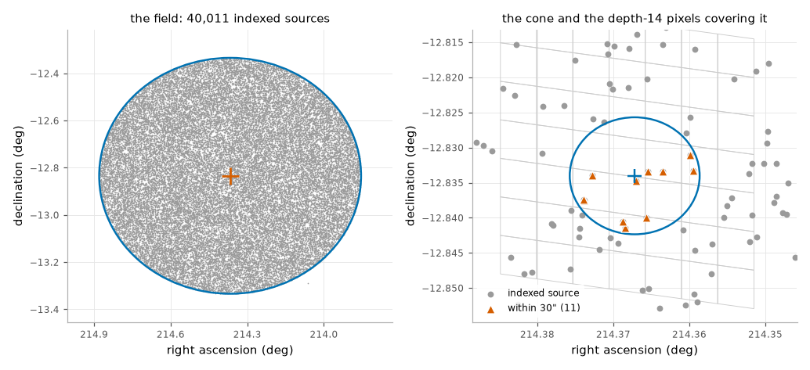

Cone Search Around a Transient
==============================

.. contents::
   :local:
   :depth: 2

**The problem.** An alert arrives: something has changed brightness at a
particular position, and you have a few minutes to decide whether it is worth a
telescope. The first question is always the same — *what is already known to be
there?* You need every cataloged source within a few arcseconds of the alert
position, with its identifier and its offset, and you need it before the object
sets.

This is the query the whole package exists for, and it is one method call.

The catalog
-----------

We will use a synthetic catalog with a shape that real ones have: a sparse
all-sky component, plus one deep field around the position of interest where the
source density is far higher.

.. code-block:: python

	import numpy as np
	from qlsc import QLSC, QLSCIndex

	rng = np.random.default_rng(seed=20200422)

	# an all-sky shallow reference catalogue
	n_sky = 500_000
	sky_ra  = rng.uniform(0., 360., n_sky)
	sky_dec = np.degrees(np.arcsin(rng.uniform(-1., 1., n_sky)))

	# one deep field, 1 degree across, around the alert
	alert_ra, alert_dec = 214.36719, -12.83402

	n_field = 40_000
	r = 0.5 * np.sqrt(rng.uniform(0., 1., n_field))          # uniform in the disc
	t = rng.uniform(0., 2. * np.pi, n_field)
	field_dec = alert_dec + r * np.sin(t)
	field_ra  = alert_ra + r * np.cos(t) / np.cos(np.radians(alert_dec))

	ra  = np.concatenate([sky_ra, field_ra])
	dec = np.concatenate([sky_dec, field_dec])
	keys = [f"SYN-{i:07d}" for i in range(len(ra))]

	print("catalogue size:", len(ra))

.. code-block:: text

	catalogue size: 540000

Two details of the construction are worth copying. Drawing declinations as
``arcsin`` of a uniform variate gives points spread uniformly over the sphere;
drawing them uniformly in declination would pile them up at the poles. And the
right ascension offsets in the field are divided by ``cos(dec)``, because a
degree of right ascension is not a degree on the sky away from the equator.

Building the index
------------------

.. code-block:: python

	index = QLSCIndex()
	index.add_points(ra=ra, dec=dec, keys=keys)
	print("indexed points:", len(index))
	print(repr(index.qlsc))

.. code-block:: text

	indexed points: 540000
	<qlsc.QLSC at 0x10555d7f0, depth=30>

That took about a second. For a catalog you will search more than once, pass
``filepath=`` to the constructor and the index is written to disk instead — build
it once, open it in every script afterwards.

The search
----------

.. code-block:: python

	matches = index.radial_query(ra=alert_ra, dec=alert_dec, radius=10./3600.,
	                             return_key=True, return_distance=True)
	print("matches within 10 arcsec:", len(matches))

	matches.sort(order="distance")
	for m in matches:
		print(f"  {m['key']}  {m['ra']:.6f} {m['dec']:+.6f}  {m['distance']*3600:7.3f}\"")

.. code-block:: text

	matches within 10 arcsec: 2
	  SYN-0517352  214.366990 -12.834740    2.686"
	  SYN-0538759  214.365509 -12.833380    6.334"

``return_key=True`` brings back the catalog identifier that was attached when the
point was added — the join back to whatever table holds the photometry. The
identifier and the distance are what let you rank candidate counterparts.

``return_distance=True`` is close to free: the cone filter already computes each
candidate's separation to decide whether it is inside, so asking for the value
only stops it being thrown away. Without either flag the result is a plain
coordinate array:

.. code-block:: python

	plain = index.radial_query(ra=alert_ra, dec=alert_dec, radius=10./3600.)
	print("plain result:", type(plain).__name__, plain.shape)

.. code-block:: text

	plain result: ndarray (2, 2)

If astropy is installed, the radius can carry units, which is one fewer place to
divide by 3600 by hand:

.. code-block:: python

	from astropy import units as u
	q = index.radial_query(ra=alert_ra, dec=alert_dec, radius=10*u.arcsec,
	                       return_distance=True)
	print("with a Quantity radius:", len(q))

.. code-block:: text

	with a Quantity radius: 2

The right panel of the figure shows the search cone with the depth-14 pixels that
cover it drawn in. Note that the pixel grid is rotated with respect to the
coordinate axes: the grid is square on the *cube face*, and this position is not
near a face centre. That rotation is invisible in normal use — the exact filter
in step 4 of :ref:`the query pipeline <how-a-region-query-works>` does not care —
but it is a good reminder that the pixels are a property of the sphere, not of
the coordinate system you happen to be plotting in.

Choosing the radius
-------------------

The number of matches rises with the area, so a factor of two in radius is a
factor of four in interlopers. It is usually worth looking at the curve before
committing to a match radius:

.. code-block:: python

	print("radius   matches")
	for arcsec in (1, 2, 5, 10, 30, 60):
		n = len(index.radial_query(ra=alert_ra, dec=alert_dec, radius=arcsec/3600.))
		print(f"{arcsec:5d}\"  {n:7d}")

.. code-block:: text

	radius   matches
	    1"        0
	    2"        0
	    5"        2
	   10"        2
	   30"       11
	   60"       44

The field here holds 40,000 sources in a disc of 0.5° radius, about 51,000 per
square degree, so the 60″ circle should contain roughly 44 — which it does. At
that density a 10″ association is already ambiguous, and this is exactly the sort
of estimate the numbers above are for.

For the nearest source alone, sort or take the minimum:

.. code-block:: python

	near = index.radial_query(ra=alert_ra, dec=alert_dec, radius=30./3600.,
	                          return_key=True, return_distance=True)
	nearest = near[np.argmin(near["distance"])]
	print("nearest source:", nearest["key"], f"{nearest['distance']*3600:.3f} arcsec")

.. code-block:: text

	nearest source: SYN-0517352 2.686 arcsec

Editing the index
-----------------

Points can be looked up and removed by key, which is how a catalog gets corrected
without being rebuilt:

.. code-block:: python

	print("'SYN-0000042' in index:", "SYN-0000042" in index)
	print("removed:", index.remove_point(key="SYN-0000042"))
	print("'SYN-0000042' in index:", "SYN-0000042" in index)
	print("indexed points:", len(index))

.. code-block:: text

	'SYN-0000042' in index: True
	removed: 1
	'SYN-0000042' in index: False
	indexed points: 539999

Is it actually faster?
----------------------

The alternative is to compute the separation to every source with NumPy and
threshold it. That is a perfectly good approach for one query. It is a bad one
for a thousand.

.. check-outputs: run-only -- wall-clock timings differ between machines and runs

.. code-block:: python

	import time

	index = QLSCIndex()
	t0 = time.perf_counter()
	index.add_points(ra=ra, dec=dec)
	print(f"build index of {len(ra):,} points: {time.perf_counter()-t0:.2f} s")

	centers_ra  = rng.uniform(0., 360., 1000)
	centers_dec = np.degrees(np.arcsin(rng.uniform(-1., 1., 1000)))

	t0 = time.perf_counter()
	for cra, cdec in zip(centers_ra, centers_dec):
		index.radial_query(ra=cra, dec=cdec, radius=1./60.)
	t = time.perf_counter() - t0
	print(f"1000 cone searches (radius 1'): {t:.2f} s  ({t*1000/1000:.2f} ms each)")

	def brute(cra, cdec, radius):
		d = np.sin(np.radians(dec - cdec)/2.)**2 + \
		    np.cos(np.radians(dec)) * np.cos(np.radians(cdec)) * \
		    np.sin(np.radians(ra - cra)/2.)**2
		return np.nonzero(d <= np.sin(np.radians(radius)/2.)**2)[0]

	t0 = time.perf_counter()
	for cra, cdec in zip(centers_ra[:100], centers_dec[:100]):
		brute(cra, cdec, 1./60.)
	t = time.perf_counter() - t0
	print(f"100 brute-force NumPy searches: {t:.2f} s  ({t*1000/100:.1f} ms each)")

	# and they agree
	cra, cdec = centers_ra[0], centers_dec[0]
	print("agreement check:", len(index.radial_query(ra=cra, dec=cdec, radius=2.)),
	      "vs", len(brute(cra, cdec, 2.)))

.. code-block:: text

	build index of 540,000 points: 1.15 s
	1000 cone searches (radius 1'): 0.07 s  (0.07 ms each)
	100 brute-force NumPy searches: 1.34 s  (13.4 ms each)
	agreement check: 143 vs 143

About 0.07 ms against 13.4 ms — a factor of nearly 200 on this machine — and the
index paid for its build time after about ninety queries. The gap widens with the
catalog: the brute-force cost is linear in the number of rows, while the index
touches only the pixels near the search position.

The last line matters as much as the timing. The two methods return the same 143
points, because the index is not an approximation: the pixel ranges only narrow
down which rows are worth testing, and every one of them is then tested exactly.

See also
--------

* :doc:`../user_guide/indexing` — the full behaviour of ``radial_query`` and its
  siblings.
* :doc:`bright_star_mask` — the same query run twenty thousand times against a
  real catalog.
* :doc:`galaxy_aperture` — when a circle is the wrong shape.
