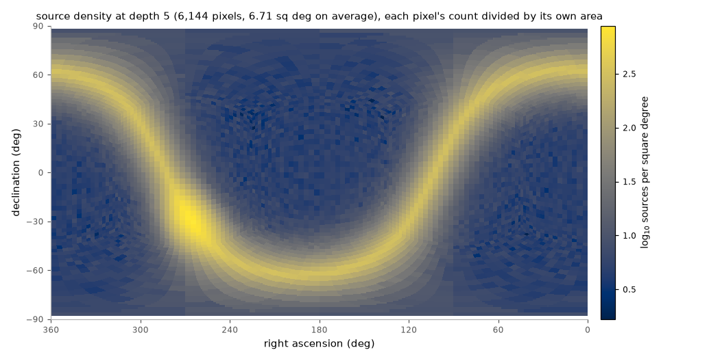
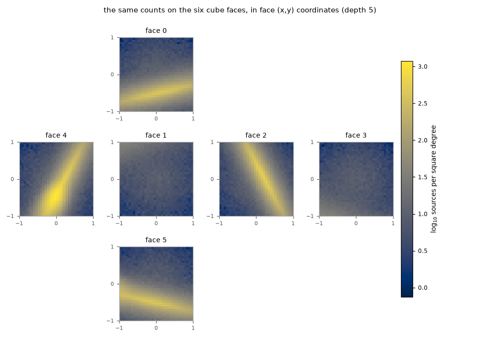

Sky Density Maps From Pixel Counts
==================================

.. contents::
   :local:
   :depth: 2

**The problem.** Before anything else, you want to *see* a catalog: where the
sources are, where the survey actually looked, where something has gone wrong. A
count of rows per pixel is the cheapest possible summary of a catalog's spatial
structure, and because the pixels nest, one pass over the data gives you the map
at every resolution at once.

This example builds a toy Milky Way, counts it into QLSC pixels, and draws it.

A catalog with structure
------------------------

Uniform random points make a dull map. This one has a thin disc, a central bulge,
and an isotropic halo, defined in galactic coordinates and converted to equatorial
with astropy:

.. code-block:: python

	import numpy as np
	from qlsc import QLSC, QLSCIndex

	rng = np.random.default_rng(seed=20200422)

	def synthetic_star_catalogue(n_disc=1_500_000, n_bulge=300_000, n_halo=200_000):
		'''A toy Milky Way: a thin disc, a central bulge, and an isotropic halo.'''
		from astropy.coordinates import SkyCoord
		from astropy import units as u

		l_disc = rng.uniform(0., 360., n_disc)
		b_disc = rng.laplace(0., 6., n_disc)
		keep = np.abs(b_disc) < 90.
		l_disc, b_disc = l_disc[keep], b_disc[keep]

		l_bulge = rng.normal(0., 12., n_bulge) % 360.
		b_bulge = rng.normal(0., 7., n_bulge)
		keep = np.abs(b_bulge) < 90.
		l_bulge, b_bulge = l_bulge[keep], b_bulge[keep]

		l_halo = rng.uniform(0., 360., n_halo)
		b_halo = np.degrees(np.arcsin(rng.uniform(-1., 1., n_halo)))

		l = np.concatenate([l_disc, l_bulge, l_halo])
		b = np.concatenate([b_disc, b_bulge, b_halo])
		icrs = SkyCoord(l=l*u.deg, b=b*u.deg, frame="galactic").icrs
		return icrs.ra.deg, icrs.dec.deg

	ra, dec = synthetic_star_catalogue()
	print(f"catalogue: {len(ra):,} sources")

	index = QLSCIndex()
	index.add_points(ra=ra, dec=dec)
	print("indexed:", f"{len(index):,}")

.. code-block:: text

	catalogue: 2,000,000 sources
	indexed: 2,000,000

.. note::

	This is a made-up galaxy, not a model of the real one. It is shaped like the
	Milky Way's star counts — exponential in latitude, concentrated toward the
	centre — because that makes the map worth looking at, not because the
	parameters mean anything.

Counting into pixels
--------------------

The count itself is two lines. :py:func:`~qlsc.QLSC.ang2ipix` is vectorized, so
the whole catalog is converted in one call, and :func:`numpy.unique` does the
grouping:

.. code-block:: python

	for depth in (3, 5, 7):
		q = QLSC(depth=depth)
		ipix = q.ang2ipix(ra=ra, dec=dec)
		occupied, counts = np.unique(ipix, return_counts=True)

		pixel_area = q.ipix_area(0, depth) * (180./np.pi)**2
		print(f"depth {depth}: {q.nbins:,} pixels, {pixel_area:.4g} square degrees each")
		print(f"  occupied pixels: {len(occupied):,} ({100*len(occupied)/q.nbins:.1f}%)")
		print(f"  counts: min {counts.min()}, median {int(np.median(counts))}, max {counts.max()}")
		hottest = occupied[np.argmax(counts)]
		hra, hdec = q.ipix2ang_center(hottest)
		print(f"  densest pixel: ipix {hottest} centred at ({hra:.3f}, {hdec:+.3f})")

.. code-block:: text

	depth 3: 384 pixels, 107.4 square degrees each
	  occupied pixels: 384 (100.0%)
	  counts: min 207, median 931, max 85187
	  densest pixel: ipix 263 centred at (262.875, -31.806)

	depth 5: 6,144 pixels, 6.714 square degrees each
	  occupied pixels: 6,144 (100.0%)
	  counts: min 5, median 57, max 7951
	  densest pixel: ipix 4309 centred at (268.210, -25.104)

	depth 7: 98,304 pixels, 0.4196 square degrees each
	  occupied pixels: 90,657 (92.2%)
	  counts: min 1, median 4, max 559
	  densest pixel: ipix 68959 centred at (269.552, -24.003)

The densest pixel is near α = 268°, δ = −25° at every depth, which is where the
bulge was put — the galactic centre is at α = 266.4°, δ = −28.9°. The occupied
fraction is the useful number for a real survey: at depth 7 only 92% of pixels
contain anything, and the empty 8% is either a genuine gap in the sky coverage or
a hole in your data.

The ``occupied`` array is the catalog's **coverage** at that resolution — the list
of pixels it touches — and comparing two catalogs' coverage lists is a set
operation on integers.

Rolling counts up the quadtree
------------------------------

Because an ipix at depth *d* is the ipix at depth *d+k* with 2*k* bits removed,
counts computed once at a fine depth can be summed into any coarser one without
touching the catalog again:

.. code-block:: python

	q7 = QLSC(depth=7)
	occ7, cnt7 = np.unique(q7.ang2ipix(ra=ra, dec=dec), return_counts=True)

	parent = occ7 >> (2 * (7 - 5))
	rolled = {}
	for p, c in zip(parent, cnt7):
		rolled[int(p)] = rolled.get(int(p), 0) + int(c)

	q5 = QLSC(depth=5)
	occ5, cnt5 = np.unique(q5.ang2ipix(ra=ra, dec=dec), return_counts=True)
	direct = {int(p): int(c) for p, c in zip(occ5, cnt5)}

	print("identical to counting at depth 5 directly:", rolled == direct)

.. code-block:: text

	identical to counting at depth 5 directly: True

Not "nearly identical" — the same dictionary. This is the property that makes the
scheme useful for storage: compute counts once, at the finest resolution you will
ever want, and derive every coarser map with a shift and a sum.

The same shift is the reason a database can store one ipix column and answer
questions at any resolution. In SQL, with an ``ipix`` column at depth 7, the
depth-5 histogram is::

	SELECT ipix >> 4 AS pixel, count(*) FROM catalogue GROUP BY pixel

``QLSCIndex`` keeps its points in an SQLite table with exactly such a column, but
the schema is deliberately an implementation detail and not something to depend
on; the ``np.unique`` version above uses only the public API and is the supported
way to do this today. A coverage export is a natural thing for the package to grow
and may appear in a future release.

Drawing it
----------

The figure is drawn by ``docs/generate_figures.py`` in the repository. It samples
the count map on a plate carrée grid rather than drawing the pixel outlines: the
pixels on the polar faces span most of the right-ascension axis when projected
this way, and the resulting polygons are unreadable. Sampling avoids that
entirely — for each grid cell, ask which pixel contains it and look up the count.

The blockiness is real: those are the depth-5 pixels, 6.7 square degrees each.
The seams where the blocks change orientation, most visible near α = 270° and
α = 105° and around the poles, are the edges of the cube faces.

For anything beyond a quick look, a projection-aware plotting library will serve
you better; the author's sibling *astplot-js* project renders sky maps
like this properly.

The same map on the cube
------------------------

Face coordinates make the tessellation obvious. Every pixel is a genuine square
on its own face, so an unfolded cube shows the counts with no projection
distortion at all:

:py:func:`~qlsc.QLSC.ipix2xy` gives the face number and the pixel's position on
that face, which converts directly to an array index:

.. code-block:: python

	q = QLSC(depth=5)
	occupied, counts = np.unique(q.ang2ipix(ra=ra, dec=dec), return_counts=True)
	facenum, x, y = q.ipix2xy(occupied)

	side = 2. / q.nside
	grid = np.full((q.nside, q.nside), np.nan)
	on_face = facenum == 2
	i = np.round((x[on_face] + 1.) / side).astype(int)
	j = np.round((y[on_face] + 1.) / side).astype(int)
	grid[j, i] = counts[on_face]
	print("face 2:", grid.shape, "pixels,", int(np.nansum(grid)), "sources")

.. code-block:: text

	face 2: (32, 32) pixels, 426240 sources

The galactic plane runs continuously across faces 4, 0, 2 and 5 in the figure,
which is the clearest way to see that the six grids really are one tessellation.

Note the ``ipix2xy(occupied)`` call: it is vectorized, so all 6,144 pixels are
converted at once.

From counts to densities
------------------------

The last step, turning counts into sources per square degree, is the one that
needs care, because :py:func:`~qlsc.QLSC.ipix_area` returns the *mean* pixel area
and the real ones vary by up to a factor of about 5.2 (see
:ref:`how-equal-are-the-pixels` and :ref:`pixel-area-trap`). A latitude profile
is fine, because it compares pixels drawn from all over the sphere:

.. code-block:: python

	from astropy.coordinates import SkyCoord
	from astropy import units as u

	q5 = QLSC(depth=5)
	occ, cnt = np.unique(q5.ang2ipix(ra=ra, dec=dec), return_counts=True)
	pra, pdec = q5.ipix2ang_center(occ)
	gal = SkyCoord(ra=pra*u.deg, dec=pdec*u.deg).galactic

	print("median count per depth-5 pixel by galactic latitude:")
	for lo, hi in [(0, 5), (5, 15), (15, 30), (30, 60), (60, 90)]:
		sel = (np.abs(gal.b.deg) >= lo) & (np.abs(gal.b.deg) < hi)
		print(f"  {lo:2d} <= |b| < {hi:2d}: {int(np.median(cnt[sel])):6d}  ({sel.sum()} pixels)")

.. code-block:: text

	median count per depth-5 pixel by galactic latitude:
	   0 <= |b| <  5:   1706  (510 pixels)
	   5 <= |b| < 15:    491  (1060 pixels)
	  15 <= |b| < 30:     91  (1504 pixels)
	  30 <= |b| < 60:     35  (2246 pixels)
	  60 <= |b| < 90:     29  (824 pixels)

A factor of nearly sixty between the plane and the poles, which is roughly what
the input distribution was built to give. But a *single pixel's* density, or a
comparison between two nearby pixels on the same face, will be biased by the area
variation unless the pixel's own area is used — the recipe is in
:ref:`pixel-area-trap`.

Finally, the pixels are distributed evenly over the faces by construction, which
is worth checking on any map that looks lopsided:

.. code-block:: python

	faces, fcounts = np.unique(occ // (q5.nside**2), return_counts=True)
	print("occupied depth-5 pixels per cube face:", dict(zip(faces.tolist(), fcounts.tolist())))

.. code-block:: text

	occupied depth-5 pixels per cube face: {0: 1024, 1: 1024, 2: 1024, 3: 1024, 4: 1024, 5: 1024}

See also
--------

* :doc:`../user_guide/scheme` — the quadtree property this page relies on.
* :doc:`pixel_regions` — the pixel-area correction, worked through.
* :doc:`../user_guide/depth` — choosing the resolution of a map.
