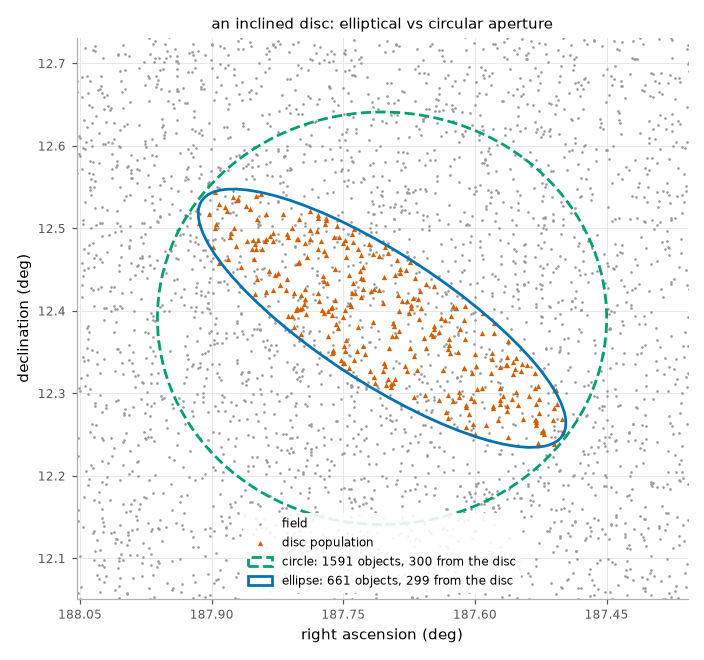

Elliptical Apertures on an Inclined Galaxy
==========================================

.. contents::
   :local:
   :depth: 2

**The problem.** You want the objects that belong to a galaxy — globular cluster
candidates, HII regions, planetary nebulae, resolved stars — and the galaxy is a
disc seen at an angle, so on the sky it is an ellipse. A circular aperture big
enough to contain the disc's major axis also contains a great deal of empty sky,
and every square degree of empty sky is another helping of foreground stars and
background galaxies in your sample.

The fix is to make the aperture the shape of the object.
:py:func:`~qlsc.QLSCIndex.ellipse_query` takes a centre, a semi-major axis, an
axis ratio, and a position angle.

A galaxy and a field
--------------------

Two populations: three hundred objects distributed through the galaxy's disc, and
a uniform field of twenty thousand over a one-degree radius. The disc has a
semi-major axis of 15 arcminutes, an axis ratio of 0.30 — a fairly inclined disc —
and a position angle of 55 degrees.

.. code-block:: python

	import numpy as np
	from qlsc import QLSC, QLSCIndex

	rng = np.random.default_rng(seed=20200422)

	GAL_RA, GAL_DEC = 187.70593, 12.39112
	A  = 0.25    # semi-major axis, degrees (15 arcmin)
	Q  = 0.30    # axis ratio b/a
	PA = 55.0    # position angle, degrees east of north

	# objects belonging to the disc
	n_disc = 300
	t = rng.uniform(0., 2*np.pi, n_disc)
	s = np.sqrt(rng.uniform(0., 1., n_disc))
	maj = A * s * np.cos(t)
	mnr = A * Q * s * np.sin(t)
	pa = np.radians(PA)
	disc_dec = GAL_DEC + maj*np.cos(pa) - mnr*np.sin(pa)
	disc_ra  = GAL_RA + (maj*np.sin(pa) + mnr*np.cos(pa)) / np.cos(np.radians(GAL_DEC))

	# a uniform foreground/background
	n_bg = 20_000
	b_r = 1.0*np.sqrt(rng.uniform(0., 1., n_bg))
	b_t = rng.uniform(0., 2*np.pi, n_bg)
	bg_dec = GAL_DEC + b_r*np.sin(b_t)
	bg_ra  = GAL_RA + b_r*np.cos(b_t)/np.cos(np.radians(GAL_DEC))

	ra   = np.concatenate([disc_ra, bg_ra])
	dec  = np.concatenate([disc_dec, bg_dec])
	keys = [f"DISC{i:03d}" for i in range(n_disc)] + [f"BG{i:05d}" for i in range(n_bg)]

	index = QLSCIndex()
	index.add_points(ra=ra, dec=dec, keys=keys)
	print("indexed:", len(index))
	print(f"background surface density: {n_bg/(np.pi*1.0**2):.0f} per square degree")

.. code-block:: text

	indexed: 20300
	background surface density: 6366 per square degree

The keys record which population each object came from, which is what lets us
measure the purity of each aperture below. In real work the equivalent is a
membership flag from spectroscopy or proper motions.

The elliptical aperture
-----------------------

.. code-block:: python

	ell = index.ellipse_query(ra=GAL_RA, dec=GAL_DEC, semi_major_axis=A,
	                          axis_ratio=Q, position_angle=PA,
	                          return_key=True, return_distance=True)
	n_disc_in = sum(1 for k in ell["key"] if k.startswith("DISC"))

	print(f"ellipse (a={A} deg, b/a={Q}, PA={PA} deg): {len(ell)} objects")
	print(f"  disc members: {n_disc_in}   field interlopers: {len(ell)-n_disc_in}")
	print(f"  ellipse area: {np.pi*A*A*Q:.5f} square degrees")
	print(f"  expected interlopers: {np.pi*A*A*Q * n_bg/np.pi:.1f}")

.. code-block:: text

	ellipse (a=0.25 deg, b/a=0.3, PA=55.0 deg): 661 objects
	  disc members: 299   field interlopers: 362
	  ellipse area: 0.05890 square degrees
	  expected interlopers: 375.0

Two hundred and ninety-nine of the three hundred disc members are recovered. The
one that is not sits at a fractional radius of 0.99975 — right on the rim, where
the flat-sky approximation used to *generate* the points and the exact spherical
test used to *select* them disagree in the fourth decimal place. That is the
correct behaviour of an exact test, not an error, and it is a useful reminder that
the aperture boundary is a real boundary.

``ellipse_query`` supports ``return_distance``, and it means the angular
separation from the **centre** of the ellipse — not a distance to the boundary.

What a circle would have cost
-----------------------------

The circumscribed circle has the same semi-major axis:

.. code-block:: python

	cir = index.radial_query(ra=GAL_RA, dec=GAL_DEC, radius=A, return_key=True)
	n_disc_c = sum(1 for k in cir["key"] if k.startswith("DISC"))

	print(f"circle of the same radius ({A} deg): {len(cir)} objects")
	print(f"  disc members: {n_disc_c}   field interlopers: {len(cir)-n_disc_c}")
	print(f"  area ratio circle/ellipse: {1/Q:.2f}")
	print(f"  purity  ellipse: {n_disc_in/len(ell):.3f}   circle: {n_disc_c/len(cir):.3f}")

.. code-block:: text

	circle of the same radius (0.25 deg): 1591 objects
	  disc members: 300   field interlopers: 1291
	  area ratio circle/ellipse: 3.33
	  purity  ellipse: 0.452   circle: 0.189

The circle finds one more disc member — the one on the rim — and 929 more field
objects to go with it. Purity goes from 45% to 19%: the sample is more than twice
as contaminated for the sake of a single extra member. The ratio is no accident,
it is exactly ``1/axis_ratio``, the ratio of the areas.

For a rounder galaxy the difference shrinks; for an edge-on disc with an axis
ratio of 0.1 the circle would admit ten times the background.

An axis ratio of 1 is a circle, and gives the same answer as
:py:func:`~qlsc.QLSCIndex.radial_query` with that radius:

.. code-block:: python

	same = index.ellipse_query(ra=GAL_RA, dec=GAL_DEC, semi_major_axis=A,
	                           axis_ratio=1.0, position_angle=0.0)
	print(f"ellipse_query with axis_ratio=1.0: {len(same)} objects "
	      f"(radial_query gave {len(cir)})")

.. code-block:: text

	ellipse_query with axis_ratio=1.0: 1591 objects (radial_query gave 1591)

The position angle convention
-----------------------------

Position angle is measured **from north through east**, the astronomical
convention. Worth checking rather than assuming, so here it is checked, with
:py:func:`~qlsc.QLSC.point_in_ellipse` on a very elongated ellipse:

.. code-block:: python

	q = QLSC()
	for angle in (0., 90.):
		north = q.point_in_ellipse(ra=GAL_RA, dec=GAL_DEC+0.20,
		                           ra_cen=GAL_RA, dec_cen=GAL_DEC,
		                           semi_major_axis=A, axis_ratio=Q, position_angle=angle)
		east = q.point_in_ellipse(ra=GAL_RA+0.20/np.cos(np.radians(GAL_DEC)), dec=GAL_DEC,
		                          ra_cen=GAL_RA, dec_cen=GAL_DEC,
		                          semi_major_axis=A, axis_ratio=Q, position_angle=angle)
		print(f"  PA={angle:4.0f}:  0.20 deg north -> {north!s:5s}   0.20 deg east -> {east}")

.. code-block:: text

	  PA=   0:  0.20 deg north -> True    0.20 deg east -> False
	  PA=  90:  0.20 deg north -> False   0.20 deg east -> True

At PA = 0 the major axis points north, so a point 0.2° north (inside the 0.25°
semi-major axis) is in and a point 0.2° east (well outside the 0.075° semi-minor
axis) is out. At PA = 90 it is the other way round.

Growing the aperture
--------------------

Because the aperture is cheap to run, a radial profile along the disc is just a
loop over semi-major axes at fixed axis ratio and position angle — a set of
nested, similar ellipses:

.. code-block:: python

	print(" a/arcmin   objects   disc   background")
	for a_arcmin in (3, 6, 9, 12, 15):
		r = index.ellipse_query(ra=GAL_RA, dec=GAL_DEC, semi_major_axis=a_arcmin/60.,
		                        axis_ratio=Q, position_angle=PA, return_key=True)
		nd = sum(1 for k in r["key"] if k.startswith("DISC"))
		print(f"   {a_arcmin:5d}    {len(r):6d}  {nd:5d}   {len(r)-nd:6d}")

.. code-block:: text

	 a/arcmin   objects   disc   background
	     3        18     10        8
	     6        98     47       51
	     9       221     99      122
	    12       412    193      219
	    15       661    299      362

The background column grows as :math:`a^2`, as it must for a fixed axis ratio; the
disc column grows the same way here only because the toy disc has a uniform
surface density. With a real profile the two columns diverge, and where they cross
is the aperture that maximises signal to noise — which is the reason to compute
this table at all.

If astropy is installed the axes and angles can carry units:

.. code-block:: python

	from astropy import units as u
	uq = index.ellipse_query(ra=GAL_RA, dec=GAL_DEC, semi_major_axis=15*u.arcmin,
	                         axis_ratio=Q, position_angle=55*u.deg)
	print("with astropy Quantities:", len(uq), "objects")

.. code-block:: text

	with astropy Quantities: 661 objects

See also
--------

* :py:func:`~qlsc.QLSC.point_in_ellipse` — the same containment test for one
  position, with no index.
* :doc:`survey_footprint` — for regions that are not conic sections.
* :doc:`../user_guide/indexing` — how the candidate selection and exact filter fit
  together.
