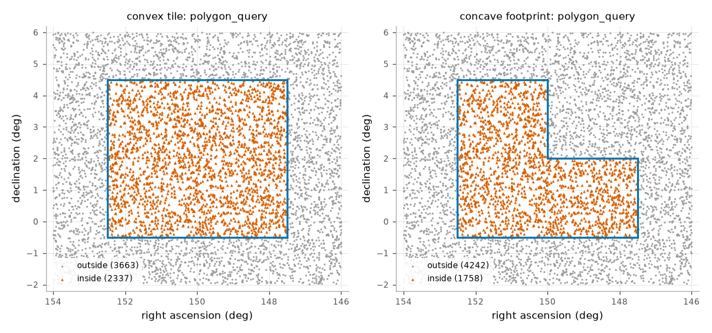

Survey Footprint Membership
===========================

.. contents::
   :local:
   :depth: 2

**The problem.** A survey covers a set of regions on the sky, and you have a list
of objects. Which of them are inside? The question is behind a lot of routine
work: deciding whether an archival image exists at a transient's position,
computing the effective area of a selection, or splitting a catalog into
"observed" and "not observed" before measuring anything.

A footprint is a polygon, not a circle, so this is
:py:func:`~qlsc.QLSCIndex.polygon_query`.

The catalog and the tile
------------------------

Two million objects spread over the whole sky, and one five-degree tile centred
on an equatorial field:

.. code-block:: python

	import numpy as np
	from qlsc import QLSC, QLSCIndex

	rng = np.random.default_rng(seed=20200422)

	n = 2_000_000
	ra  = rng.uniform(0., 360., n)
	dec = np.degrees(np.arcsin(rng.uniform(-1., 1., n)))
	keys = [f"OBJ{i:07d}" for i in range(n)]

	index = QLSCIndex()
	index.add_points(ra=ra, dec=dec, keys=keys)
	print("indexed:", len(index))
	print(f"surface density: {n / 41252.96:.1f} objects per square degree")

	ra_c, dec_c = 150.0, 2.0
	half = 2.5
	sec = 1. / np.cos(np.radians(dec_c))
	tile = np.array([
		[ra_c - half*sec, dec_c - half],
		[ra_c + half*sec, dec_c - half],
		[ra_c + half*sec, dec_c + half],
		[ra_c - half*sec, dec_c + half],
	])

.. code-block:: text

	indexed: 2000000
	surface density: 48.5 objects per square degree

A polygon is an ``(n,2)`` array of ``ra,dec`` vertices in degrees. Winding order
does not matter, and the first vertex must *not* be repeated at the end.

.. code-block:: python

	inside = index.polygon_query(polygon=tile, return_key=True)
	print("objects inside:", len(inside))
	print("result fields:", inside.dtype.names)
	print("first three:", [str(k) for k in inside["key"][:3]])

.. code-block:: text

	objects inside: 1277
	result fields: ('ra', 'dec', 'key')
	first three: ['OBJ1620523', 'OBJ1586591', 'OBJ0210858']

Twenty-five square degrees at 48.5 objects per square degree is about 1212
expected; 1277 is a normal fluctuation for a Poisson count of that size.

``polygon_query`` takes ``return_key`` but not ``return_distance`` — a polygon
has no centre to measure a separation from.

Footprints with holes in them
-----------------------------

Real footprints are rarely rectangles. Detector gaps, guide-probe shadows, and
masked regions all make them concave, and concave polygons are supported:

.. code-block:: python

	notched = np.array([
		[ra_c - half*sec, dec_c - half],
		[ra_c + half*sec, dec_c - half],
		[ra_c + half*sec, dec_c + half],
		[ra_c,            dec_c + half],
		[ra_c,            dec_c],
		[ra_c - half*sec, dec_c],
	])
	inside_notched = index.polygon_query(polygon=notched)
	print("objects inside:", len(inside_notched))
	print(f"fraction of the full tile: {len(inside_notched)/len(inside):.3f}")

.. code-block:: text

	objects inside: 981
	fraction of the full tile: 0.768

Three quarters of the area, and 0.768 of the objects — again within the counting
noise of the expected 0.75.

Concave shapes work because of how the query is built. The coverage step, which
picks the pixels worth looking at, is allowed to be *generous*: Q3C calls a pixel
fully covered when all four of its corners are inside the polygon, which for a
concave shape can include area that is not. That produces extra candidates, never
missing ones, and the extra candidates are removed by the exact containment test
applied to every row. Generosity in the coverage step costs time, not
correctness.

One position at a time
----------------------

:py:func:`~qlsc.QLSC.point_in_polygon` answers the same question without an index,
using the same test:

.. code-block:: python

	q = QLSC()
	for test_ra, test_dec, what in [(150.5, 2.0, "east of centre"),
	                                (149.5, 3.5, "north-west quadrant"),
	                                (146.0, 2.0, "outside the tile")]:
		print(f"  ({test_ra:6.1f},{test_dec:+5.1f}) {what:22s} "
		      f"tile={q.point_in_polygon(ra=test_ra, dec=test_dec, polygon=tile)!s:5s}"
		      f" notched={q.point_in_polygon(ra=test_ra, dec=test_dec, polygon=notched)}")

.. code-block:: text

	  ( 150.5, +2.0) east of centre         tile=True  notched=True
	  ( 149.5, +3.5) north-west quadrant    tile=True  notched=False
	  ( 146.0, +2.0) outside the tile       tile=False notched=False

The edges are great circles
---------------------------

This is the trap in the whole exercise. A polygon's edges follow **great
circles**, not lines of constant declination. Four vertices at ``dec = ±15`` do
not enclose the band ``-15 ≤ dec ≤ +15``: the top edge bows *north* of +15 between
its endpoints.

.. code-block:: python

	box = np.array([[-15., -15.], [15., -15.], [15., 15.], [-15., 15.]])
	for d in (15.0, 15.3, 15.5, 15.6):
		print(f"  (ra=0, dec={d:.1f}) inside: {q.point_in_polygon(ra=0., dec=d, polygon=box)}")

	print("  great circle through (-15,+15) and (+15,+15) reaches dec = "
	      f"{np.degrees(np.arctan(np.tan(np.radians(15.))/np.cos(np.radians(15.)))):.3f} at ra=0")

.. code-block:: text

	  (ra=0, dec=15.0) inside: True
	  (ra=0, dec=15.3) inside: True
	  (ra=0, dec=15.5) inside: True
	  (ra=0, dec=15.6) inside: False
	  great circle through (-15,+15) and (+15,+15) reaches dec = 15.504 at ra=0

The boundary is where the geometry says it should be, half a degree beyond the
declination of the vertices. On the five-degree tile above the same effect is
0.0001° and can be ignored; on a thirty-degree footprint it is half a degree of
sky. If you want a strict declination band, add intermediate vertices along the
edge — each pair of them is then a short great-circle segment that hugs the
parallel closely.

How large can a polygon be?
---------------------------

The polygon has to project onto a single cube face, so there is a limit, and it
depends on where the polygon sits: a footprint centred on a face centre can be far
larger than one straddling a face edge.

.. code-block:: python

	def square(size, cra, cdec):
		h = size / 2.
		s = 1. / np.cos(np.radians(cdec))
		return np.array([[cra - h*s, cdec - h], [cra + h*s, cdec - h],
		                 [cra + h*s, cdec + h], [cra - h*s, cdec + h]])

	for cra, cdec in [(0, 0), (20, 0), (45, 0), (45, 44), (0, 60)]:
		last, err = None, None
		for size in range(1, 90):
			try:
				index.polygon_query(polygon=square(size, cra, cdec))
				last = size
			except Exception as e:
				err = type(e).__name__
				break
		print(f"  centre ({cra:2d},{cdec:2d}): up to {last:2d} deg, then {err}")

.. code-block:: text

	  centre ( 0, 0): up to 76 deg, then ValueError
	  centre (20, 0): up to 50 deg, then ValueError
	  centre (45, 0): up to 43 deg, then ValueError
	  centre (45,44): up to 64 deg, then ValueError
	  centre ( 0,60): up to 47 deg, then ValueError

The API documentation quotes roughly 23 degrees as the figure that is safe
anywhere; the measurements above show the real limit is larger but strongly
position-dependent, so 23 degrees is the number to design against if the footprint
could be anywhere. What matters more is that going over the limit **raises**:

.. code-block:: python

	try:
		index.polygon_query(polygon=square(80, 0., 0.))
	except ValueError as e:
		print(type(e).__name__ + ":", e)

.. code-block:: text

	ValueError: The polygon is too large for the Q3C face projection; split it into smaller polygons.

A second, rarer failure is ``qlsc.q3c.RangeOverflowError``, raised when the
coverage step wants to emit more ipix ranges than it has room for. The cone and
ellipse queries deal with that by growing the search region and retrying — a
larger region gives fewer, coarser ranges — but a polygon has no single size to
grow, so it reaches the caller.

Either way the remedy is the same and it is the one the message gives: **split the
footprint**. Tile a large survey area into a few dozen smaller polygons, query
each, and concatenate. That is closer to how footprints are actually described
anyway, since a survey is usually a union of pointings rather than one giant
shape.

See also
--------

* :doc:`../user_guide/indexing` — the query pipeline and why concave polygons are
  safe.
* :doc:`galaxy_aperture` — the elliptical region query.
* :py:func:`~qlsc.QLSC.ipix2polygon` — the corners of a pixel, in the same format
  ``polygon_query`` accepts, so a pixel can be used directly as a footprint.
