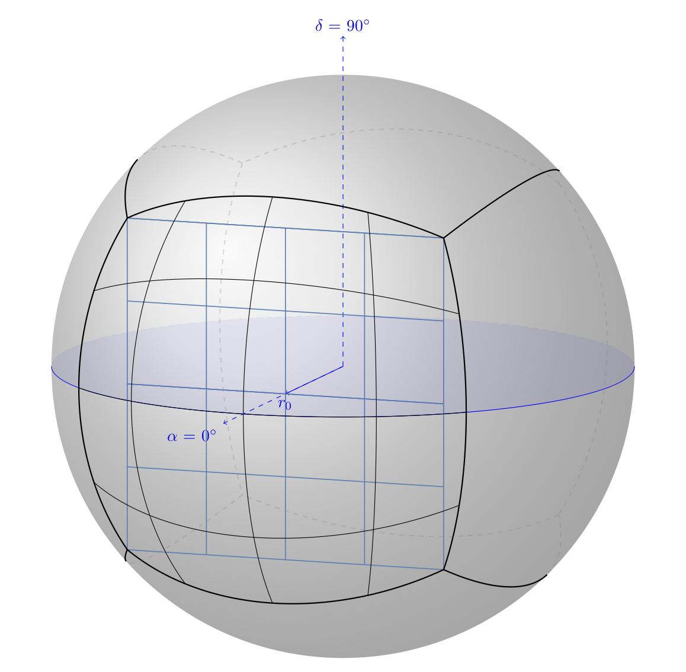

.. QLSC Python Module documentation master file, created by
   sphinx-quickstart on Wed Apr 22 02:59:23 2020.
   You can adapt this file completely to your liking, but it should at least
   contain the root `toctree` directive.

QLSC: Quadrilateralized Spherical Cube for Python
=================================================

The quadrilateralized spherical cube (QLSC) is a scheme for cutting a sphere into
pixels of very nearly equal area, designed so that positions close together on the
sphere get index numbers close together as integers. That property is what makes it
useful: a cone search, a footprint test, or a density map becomes a query over a
handful of integer ranges instead of a pass over every row of a catalog.

*qlsc* is an implementation of the scheme in a Python package. Parts of it are based
on code from Sergey Koposov's `Q3C <https://github.com/segasai/q3c>`_, a PostgreSQL
extension that implements QLSC indexing; in addition to sphere segmentation, this
package provides the catalog indexing functionality of Q3C without the need to
install a PostgreSQL database.

Note that while this package is designed for astronomical use (it focusses
on right ascension and declination), it could be just as easily be used for
latitude and longitude coordinates, as long as you're ok with a perfectly
spherical Earth (though QLSC was designed to be used with the real Earth).
Future updates may better facilitate this, but contributions are welcome.

A cone search in ten lines
--------------------------

.. code-block:: python

	from qlsc import QLSCIndex
	from qlsc.generate import sunflower_points_on_sphere

	index = QLSCIndex()                              # in memory, highest resolution
	index.add_points(points=sunflower_points_on_sphere(n=1e6))

	matches = index.radial_query(ra=56., dec=-40., radius=0.5, return_distance=True)

	print(len(matches), "sources within half a degree")
	for row in matches[:3]:
		print(f"{row['ra']:.5f} {row['dec']:+.5f}  {row['distance']*3600:.1f} arcsec")

.. code-block:: text

	19 sources within half a degree
	55.97517 -39.62402  1355.3 arcsec
	56.23910 -39.71483  1220.9 arcsec
	56.50303 -39.80577  1555.3 arcsec

:doc:`getting_started` walks through that example line by line.

Where to go from here
---------------------

* :doc:`getting_started` — install the package and run your first query.
* :doc:`user_guide/index` — how the scheme works, and what each part of the API is for.
* :doc:`examples/index` — worked science cases with real, runnable code.
* :doc:`api` — the complete API reference.

.. toctree::
   :maxdepth: 2
   :caption: Getting started

   getting_started

.. toctree::
   :maxdepth: 2
   :caption: User guide

   user_guide/index

.. toctree::
   :maxdepth: 2
   :caption: Worked examples

   examples/index

.. toctree::
   :maxdepth: 2
   :caption: Reference

   api

Citing and further reading
--------------------------

The scheme was first described by F.K. Chan and E.M. O'Neill in a 1975 technical
report, `Feasibility Study of a Quadrilateralized Spherical Cube Earth Data Base
<https://ntrl.ntis.gov/NTRL/dashboard/searchResults/titleDetail/ADA010232.xhtml>`_
(an abridged version is `available from NASA
<https://ntrs.nasa.gov/archive/nasa/casi.ntrs.nasa.gov/19810002572.pdf>`_).
The indexing scheme this package implements is the one described in
`Koposov & Bartunov (2006)
<https://ui.adsabs.harvard.edu/abs/2006ASPC..351..735K/abstract>`_,
*Q3C, Quad Tree Cube -- The new Sky-indexing Concept for Huge Astronomical
Catalogues and its Realization for Main Astronomical Queries (Cone Search and
Xmatch) in Open Source Database PostgreSQL*, ASP Conference Series 351, 735.

Further links are collected in :doc:`user_guide/scheme`.

Indices and tables
==================

* :ref:`genindex`
* :ref:`modindex`
* :ref:`search`
