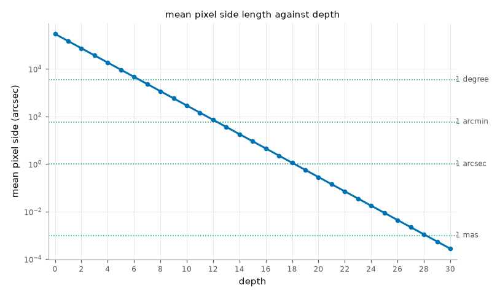

Depth and Resolution
====================

.. contents::
   :local:
   :depth: 2

A :py:class:`~qlsc.QLSC` object is defined by one number, its ``depth``: how many
times each cube face has been cut into four. Everything else — the pixel count,
the pixel size, the number of bits in an ipix — follows from it.

.. code-block:: text

	nside                = 2**depth            (pixels along one edge of a face)
	pixels per cube face = nside**2
	pixels on the sphere = 6 * nside**2
	mean pixel area      = 4*pi / (6 * nside**2)  steradians

``depth`` must be an integer in ``[0,30]``. Thirty is the limit because the ipix
of a depth-30 pixel already needs 63 bits, the width of a signed 64-bit integer —
the same limit the Q3C PostgreSQL extension works to, and the reason ``depth=30``
is this package's default.

Matching a depth to an angular scale
------------------------------------

The most common reason to pick a depth is to make the pixel comparable to some
physical scale — a beam, a seeing disc, a tile. The mean pixel side is
:math:`\sqrt{4\pi / (6\,\mathrm{nside}^2)}`:

.. code-block:: python

	import numpy as np
	from qlsc import QLSC

	sides = {d: np.sqrt(QLSC(depth=d).ipix_area(0, d)) * 180/np.pi for d in range(31)}

	for name, scale in [("Gaia astrometric precision, 0.1 mas", 0.1/3.6e6),
	                    ("HST/ACS pixel, 0.05 arcsec", 0.05/3600),
	                    ("SDSS median seeing, 1.4 arcsec", 1.4/3600),
	                    ("2MASS beam, 2 arcsec", 2./3600),
	                    ("WISE W1 beam, 6.1 arcsec", 6.1/3600),
	                    ("Planck 217 GHz beam, 5 arcmin", 5./60),
	                    ("a 1 degree survey tile", 1.0)]:
		hit = [d for d in range(31) if sides[d] <= scale]
		if hit:
			print(f"  {name:36s} -> depth {hit[0]:2d}  (pixel side {sides[hit[0]]*3600:.4g} arcsec)")
		else:
			print(f"  {name:36s} -> no depth is fine enough (depth 30 is {sides[30]*3.6e6:.4g} mas)")

.. code-block:: text

	  Gaia astrometric precision, 0.1 mas  -> no depth is fine enough (depth 30 is 0.278 mas)
	  HST/ACS pixel, 0.05 arcsec           -> depth 23  (pixel side 0.03558 arcsec)
	  SDSS median seeing, 1.4 arcsec       -> depth 18  (pixel side 1.139 arcsec)
	  2MASS beam, 2 arcsec                 -> depth 18  (pixel side 1.139 arcsec)
	  WISE W1 beam, 6.1 arcsec             -> depth 16  (pixel side 4.555 arcsec)
	  Planck 217 GHz beam, 5 arcmin        -> depth 10  (pixel side 291.5 arcsec)
	  a 1 degree survey tile               -> depth  7  (pixel side 2332 arcsec)

The finest available pixel is 0.278 milliarcseconds on a side. That is smaller
than any current astrometric measurement but, as the first line shows, not
arbitrarily so — the resolution is finite and worth knowing when a pixel is being
used as an identifier for a position rather than as an area.

.. note::

	These are *mean* pixel sizes. Actual pixels vary by up to a factor of about
	5.2 in area between the centre of a cube face and a cube vertex; see
	:ref:`how-equal-are-the-pixels`.

Does the depth affect a search?
-------------------------------

Not the answer, only the work. Every region query in :py:class:`~qlsc.QLSCIndex`
computes its candidate pixel ranges at depth 30 regardless of the index's own
depth, maps those ranges down, and then applies the exact geometric test to each
candidate row. A coarser index produces fewer, wider ranges — more candidates to
test — but the same matches:

.. code-block:: python

	from qlsc import QLSC, QLSCIndex
	from qlsc.generate import sunflower_points_on_sphere

	points = sunflower_points_on_sphere(n=200_000)
	answers = {}
	for depth in (0, 4, 10, 20, 30):
		index = QLSCIndex(qlsc=QLSC(depth=depth))
		index.add_points(points=points)
		answers[depth] = len(index.radial_query(ra=56., dec=-40., radius=2.0))
	print(answers)

.. code-block:: text

	{0: 58, 4: 58, 10: 58, 20: 58, 30: 58}

Even ``depth=0``, where the whole sphere is six pixels and the "candidate range"
is most of a cube face, gives the same 58 points. It just reads more rows to get
there.

How much more? For a half-million point index searched at a one-degree radius,
measured on an Apple M1 with Python 3.13 and SQLite's own index on the ipix
column doing the work:

.. code-block:: text

	depth   build/s   500 queries/s   ms per query   matches   file size/MB
	    6      3.03            0.20           0.39     19253           33.5
	   10      2.95            0.13           0.26     19253           34.5
	   14      2.99            0.13           0.26     19253           35.6
	   20      2.74            0.13           0.26     19253           37.6
	   26      2.87            0.13           0.27     19253           39.6
	   30      2.76            0.13           0.27     19253           39.6

For this workload the depth barely matters: only the coarsest setting is
measurably slower, and the on-disk cost of the finest is about 18% above the
coarsest, from storing larger integers. Do not read that as a general result —
a heavily clustered catalog searched at arcsecond radii will punish a coarse
depth much harder, because a single coarse pixel can hold a large fraction of the
catalog. The safe default is to leave the depth alone unless you have a reason,
and the usual reasons are:

* You are using the ipix value itself as a **grouping key** — a density map, a
  coverage list, a partition key for storage. Then the depth is the resolution of
  your analysis and should be chosen for that; see :doc:`../examples/density_map`.
* You want **smaller integers** in an external table or a file format.
* You are matching an existing Q3C-indexed PostgreSQL table, in which case
  ``depth=30`` is the value to use.

The full table
--------------

Pixels per cube face is ``nside**2``; the area columns are means over the whole
sphere.

.. table::
   :widths: auto

   +-------+---------------+---------------------------+----------------+--------------------+-----------------+
   | Depth | nside         | Pixels on sphere          | Mean area (sr) | Mean area (sq deg) | Mean pixel side |
   +=======+===============+===========================+================+====================+=================+
   | 0     | 1             | 6                         | 2.0944E+00     | 6.8755E+03         | 82.92 deg       |
   +-------+---------------+---------------------------+----------------+--------------------+-----------------+
   | 1     | 2             | 24                        | 5.2360E-01     | 1.7189E+03         | 41.46 deg       |
   +-------+---------------+---------------------------+----------------+--------------------+-----------------+
   | 2     | 4             | 96                        | 1.3090E-01     | 4.2972E+02         | 20.73 deg       |
   +-------+---------------+---------------------------+----------------+--------------------+-----------------+
   | 3     | 8             | 384                       | 3.2725E-02     | 1.0743E+02         | 10.36 deg       |
   +-------+---------------+---------------------------+----------------+--------------------+-----------------+
   | 4     | 16            | 1,536                     | 8.1812E-03     | 2.6857E+01         | 5.182 deg       |
   +-------+---------------+---------------------------+----------------+--------------------+-----------------+
   | 5     | 32            | 6,144                     | 2.0453E-03     | 6.7143E+00         | 2.591 deg       |
   +-------+---------------+---------------------------+----------------+--------------------+-----------------+
   | 6     | 64            | 24,576                    | 5.1133E-04     | 1.6786E+00         | 1.296 deg       |
   +-------+---------------+---------------------------+----------------+--------------------+-----------------+
   | 7     | 128           | 98,304                    | 1.2783E-04     | 4.1965E-01         | 38.87 arcmin    |
   +-------+---------------+---------------------------+----------------+--------------------+-----------------+
   | 8     | 256           | 393,216                   | 3.1958E-05     | 1.0491E-01         | 19.43 arcmin    |
   +-------+---------------+---------------------------+----------------+--------------------+-----------------+
   | 9     | 512           | 1,572,864                 | 7.9895E-06     | 2.6228E-02         | 9.717 arcmin    |
   +-------+---------------+---------------------------+----------------+--------------------+-----------------+
   | 10    | 1,024         | 6,291,456                 | 1.9974E-06     | 6.5570E-03         | 4.859 arcmin    |
   +-------+---------------+---------------------------+----------------+--------------------+-----------------+
   | 11    | 2,048         | 25,165,824                | 4.9934E-07     | 1.6392E-03         | 2.429 arcmin    |
   +-------+---------------+---------------------------+----------------+--------------------+-----------------+
   | 12    | 4,096         | 100,663,296               | 1.2484E-07     | 4.0981E-04         | 1.215 arcmin    |
   +-------+---------------+---------------------------+----------------+--------------------+-----------------+
   | 13    | 8,192         | 402,653,184               | 3.1209E-08     | 1.0245E-04         | 36.44 arcsec    |
   +-------+---------------+---------------------------+----------------+--------------------+-----------------+
   | 14    | 16,384        | 1,610,612,736             | 7.8022E-09     | 2.5613E-05         | 18.22 arcsec    |
   +-------+---------------+---------------------------+----------------+--------------------+-----------------+
   | 15    | 32,768        | 6,442,450,944             | 1.9506E-09     | 6.4033E-06         | 9.11 arcsec     |
   +-------+---------------+---------------------------+----------------+--------------------+-----------------+
   | 16    | 65,536        | 25,769,803,776            | 4.8764E-10     | 1.6008E-06         | 4.555 arcsec    |
   +-------+---------------+---------------------------+----------------+--------------------+-----------------+
   | 17    | 131,072       | 103,079,215,104           | 1.2191E-10     | 4.0021E-07         | 2.277 arcsec    |
   +-------+---------------+---------------------------+----------------+--------------------+-----------------+
   | 18    | 262,144       | 412,316,860,416           | 3.0477E-11     | 1.0005E-07         | 1.139 arcsec    |
   +-------+---------------+---------------------------+----------------+--------------------+-----------------+
   | 19    | 524,288       | 1,649,267,441,664         | 7.6194E-12     | 2.5013E-08         | 569.4 mas       |
   +-------+---------------+---------------------------+----------------+--------------------+-----------------+
   | 20    | 1,048,576     | 6,597,069,766,656         | 1.9048E-12     | 6.2532E-09         | 284.7 mas       |
   +-------+---------------+---------------------------+----------------+--------------------+-----------------+
   | 21    | 2,097,152     | 26,388,279,066,624        | 4.7621E-13     | 1.5633E-09         | 142.3 mas       |
   +-------+---------------+---------------------------+----------------+--------------------+-----------------+
   | 22    | 4,194,304     | 105,553,116,266,496       | 1.1905E-13     | 3.9083E-10         | 71.17 mas       |
   +-------+---------------+---------------------------+----------------+--------------------+-----------------+
   | 23    | 8,388,608     | 422,212,465,065,984       | 2.9763E-14     | 9.7707E-11         | 35.58 mas       |
   +-------+---------------+---------------------------+----------------+--------------------+-----------------+
   | 24    | 16,777,216    | 1,688,849,860,263,936     | 7.4408E-15     | 2.4427E-11         | 17.79 mas       |
   +-------+---------------+---------------------------+----------------+--------------------+-----------------+
   | 25    | 33,554,432    | 6,755,399,441,055,744     | 1.8602E-15     | 6.1067E-12         | 8.896 mas       |
   +-------+---------------+---------------------------+----------------+--------------------+-----------------+
   | 26    | 67,108,864    | 27,021,597,764,222,976    | 4.6505E-16     | 1.5267E-12         | 4.448 mas       |
   +-------+---------------+---------------------------+----------------+--------------------+-----------------+
   | 27    | 134,217,728   | 108,086,391,056,891,904   | 1.1626E-16     | 3.8167E-13         | 2.224 mas       |
   +-------+---------------+---------------------------+----------------+--------------------+-----------------+
   | 28    | 268,435,456   | 432,345,564,227,567,616   | 2.9066E-17     | 9.5417E-14         | 1.112 mas       |
   +-------+---------------+---------------------------+----------------+--------------------+-----------------+
   | 29    | 536,870,912   | 1,729,382,256,910,270,464 | 7.2664E-18     | 2.3854E-14         | 556 µas         |
   +-------+---------------+---------------------------+----------------+--------------------+-----------------+
   | 30    | 1,073,741,824 | 6,917,529,027,641,081,856 | 1.8166E-18     | 5.9635E-15         | 278 µas         |
   +-------+---------------+---------------------------+----------------+--------------------+-----------------+

