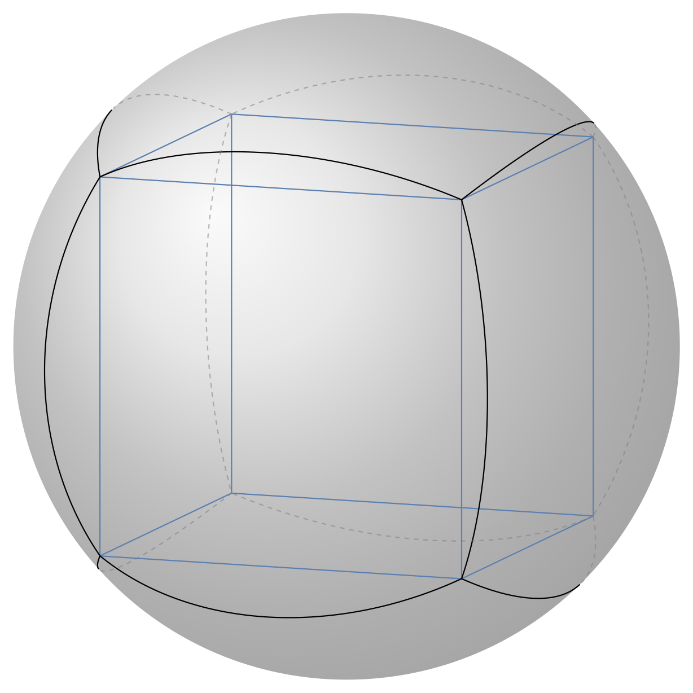
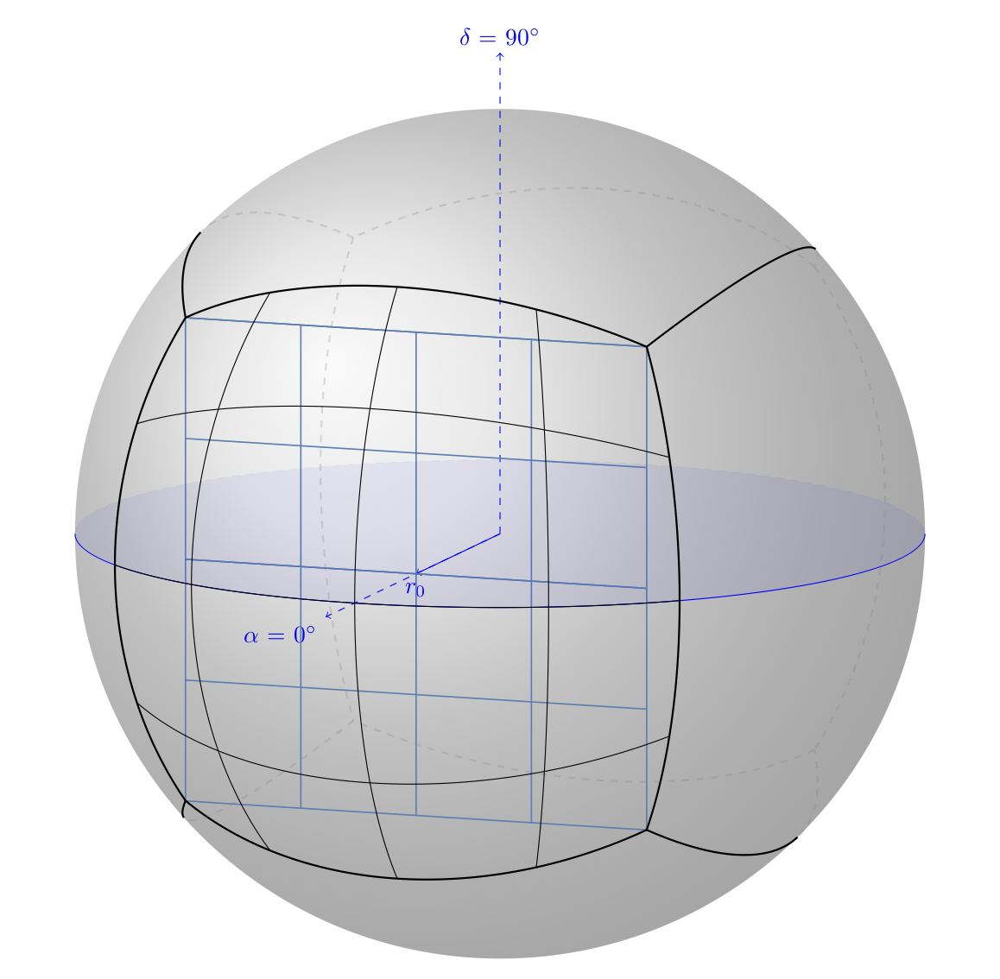
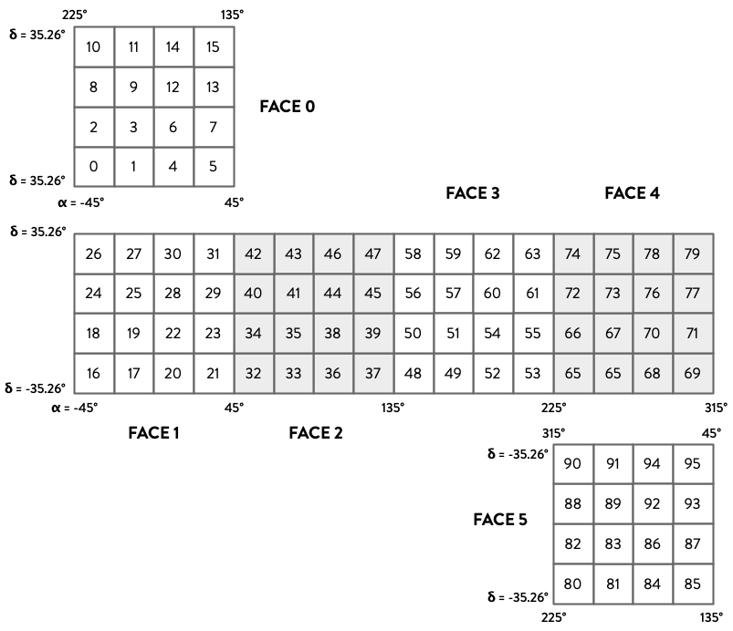

The QLSC Scheme
===============

.. contents::
   :local:
   :depth: 2

This page is the long version of the introduction in the project's README: what
the pixels are, how they are numbered, and which properties of the numbering the
rest of the package depends on.

A cube inside a sphere
----------------------

The quadrilateralized spherical cube was devised in 1975 by F.K. Chan and
E.M. O'Neill in a technical report for the U.S. Navy (`Feasibility Study of a
Quadrilateralized Spherical Cube Earth Data Base
<https://ntrl.ntis.gov/NTRL/dashboard/searchResults/titleDetail/ADA010232.xhtml>`_).
It begins with a cube inscribed in a sphere:

Each of the six square faces is projected outward onto the sphere. A square grid
drawn on a face therefore becomes a grid of curved quadrilaterals on the sphere —
"quadrilateralized" — and six such grids tile the whole sphere with no gaps, no
overlaps, and, importantly, no singularity at the poles. The poles are ordinary
interior points of two of the faces.

The scheme is a *hierarchy*, not a single grid. At the coarsest level each face
is one pixel and the sphere has six. Each further level cuts every pixel into
four:

The number of subdivisions is what this package calls the **depth**. The number
of pixels follows from it:

.. code-block:: text

	pixels per cube face = (2**depth)**2
	pixels on the sphere = 6 * (2**depth)**2

``depth=0`` is the bare cube; ``depth=30`` is the finest the code supports and is
the value the Q3C PostgreSQL extension uses. :doc:`depth` has the numbers for
every level and advice on choosing one.

.. note::

	The projection Q3C — and therefore this package — actually uses is the
	*tangent-plane* (gnomonic) cube: a point's position on a face is
	:math:`(\tan\Delta\lambda, \ldots)`, not the area-preserving curvilinear
	transform of the original Chan & O'Neill paper. The tessellation is the same
	shape, the indexing properties are the same, and it is much cheaper to
	compute — but the pixels are *not* equal-area. See
	:ref:`how-equal-are-the-pixels` below for what the variation actually is,
	measured.

The six faces
-------------

The faces are numbered 0 to 5: face 0 is the north cap, faces 1 to 4 are the
equatorial band, and face 5 is the south cap.

+-------------+----------------------+------------------------+
| Face number | Region               | Face centre            |
+=============+======================+========================+
| 0           | north cap            | α = 0°, δ = +90°       |
+-------------+----------------------+------------------------+
| 1           | −45° ≤ α < 45°       | α = 0°, δ = 0°         |
+-------------+----------------------+------------------------+
| 2           | 45° ≤ α < 135°       | α = 90°, δ = 0°        |
+-------------+----------------------+------------------------+
| 3           | 135° ≤ α < 225°      | α = 180°, δ = 0°       |
+-------------+----------------------+------------------------+
| 4           | 225° ≤ α < 315°      | α = 270°, δ = 0°       |
+-------------+----------------------+------------------------+
| 5           | south cap            | α = 0°, δ = −90°       |
+-------------+----------------------+------------------------+

The boundary between the caps and the equatorial band is not a line of constant
declination: it is the edge of the cube, which reaches δ = ±45° at the middle
of each face edge and δ = ±35.264° (= arctan 1/√2) at the cube's vertices.
:py:func:`~qlsc.QLSC.face_number` answers the question for any position, taking
either a coordinate or an ipix; :py:func:`~qlsc.QLSC.ipix2face` takes an ipix
only:

.. code-block:: python

	from qlsc import QLSC
	q = QLSC(depth=2)

	for ra, dec, what in [(0., 90., "north pole"), (0., 0., "ra=0 on the equator"),
	                      (90., 0., "ra=90"), (180., 0., "ra=180"), (270., 0., "ra=270"),
	                      (0., -90., "south pole"), (0., 50., "ra=0, dec=+50"),
	                      (0., 40., "ra=0, dec=+40"), (44., 0., "ra=44"), (46., 0., "ra=46")]:
		print(f"  {what:22s} ({ra:6.1f},{dec:+6.1f}) -> face {q.face_number(ra, dec)}")

.. code-block:: text

	  north pole             (   0.0, +90.0) -> face 0
	  ra=0 on the equator    (   0.0,  +0.0) -> face 1
	  ra=90                  (  90.0,  +0.0) -> face 2
	  ra=180                 ( 180.0,  +0.0) -> face 3
	  ra=270                 ( 270.0,  +0.0) -> face 4
	  south pole             (   0.0, -90.0) -> face 5
	  ra=0, dec=+50          (   0.0, +50.0) -> face 0
	  ra=0, dec=+40          (   0.0, +40.0) -> face 1
	  ra=44                  (  44.0,  +0.0) -> face 1
	  ra=46                  (  46.0,  +0.0) -> face 2

Pixel numbers are laid out face by face, so a face's pixels are a contiguous
block: the first ``nside**2`` pixel numbers are on face 0, the next
``nside**2`` on face 1, and so on.

.. code-block:: python

	print("a face holds nside*nside =", q.nside**2, "pixels at depth", q.depth)
	for ipix in (0, 15, 16, 42, 95):
		print(f"  ipix {ipix:3d}: ipix2face -> {q.ipix2face(ipix)}"
		      f"   face_number(ipix=...) -> {q.face_number(ipix=ipix)}")

.. code-block:: text

	a face holds nside*nside = 16 pixels at depth 2
	  ipix   0: ipix2face -> 0   face_number(ipix=...) -> 0
	  ipix  15: ipix2face -> 0   face_number(ipix=...) -> 0
	  ipix  16: ipix2face -> 1   face_number(ipix=...) -> 1
	  ipix  42: ipix2face -> 2   face_number(ipix=...) -> 2
	  ipix  95: ipix2face -> 5   face_number(ipix=...) -> 5

The pixel number
----------------

Every pixel has an integer identifier, called its **ipix**. Within a face the
pixels are numbered along a `Z-order curve
<https://en.wikipedia.org/wiki/Z-order_curve>`_, which is what makes the whole
scheme useful. This is the numbering over the whole sphere at ``depth=2``:

Two properties follow from that curve, and everything else in this package rests
on them.

**An ipix is a path down a quadtree.** Each level of subdivision appends two bits
to the number, choosing one of the four children. So the ipix at a coarser depth
is simply the ipix at a finer depth with the low bits removed — no trigonometry
required:

.. code-block:: python

	q30 = QLSC(depth=30)
	ra, dec = 83.822083, -5.391111
	ipix = q30.ang2ipix(ra, dec)
	print(f"  depth 30 ipix of ({ra},{dec}): {ipix}")
	print(f"  in binary: {ipix:b}  ({ipix.bit_length()} bits)")

	for depth in (0, 1, 2, 3, 4, 6, 10):
		qd = QLSC(depth=depth)
		shifted = ipix >> (2 * (30 - depth))
		print(f"    depth {depth:2d}: ipix30 >> {2*(30-depth):2d} = {shifted:12d}"
		      f"   == ang2ipix at depth {depth}: {shifted == qd.ang2ipix(ra, dec)}")

.. code-block:: text

	  depth 30 ipix of (83.822083,-5.391111): 2589827523372428891
	  in binary: 10001111110000111010100110100100111000001001001010111001011011  (62 bits)
	    depth  0: ipix30 >> 60 =            2   == ang2ipix at depth 0: True
	    depth  1: ipix30 >> 58 =            8   == ang2ipix at depth 1: True
	    depth  2: ipix30 >> 56 =           35   == ang2ipix at depth 2: True
	    depth  3: ipix30 >> 54 =          143   == ang2ipix at depth 3: True
	    depth  4: ipix30 >> 52 =          575   == ang2ipix at depth 4: True
	    depth  6: ipix30 >> 48 =         9200   == ang2ipix at depth 6: True
	    depth 10: ipix30 >> 40 =      2355434   == ang2ipix at depth 10: True

:py:func:`~qlsc.QLSC.ipix_up` and :py:func:`~qlsc.QLSC.ipix_down` are the same
operation with the shift written for you:

.. code-block:: python

	q5 = QLSC(depth=5)
	parent = q5.ang2ipix(ra, dec)
	print(f"  depth 5 pixel {parent} -> depth 6 children {q5.ipix_down(parent)}")
	print(f"  and its depth 4 parent: {q5.ipix_up(parent)}")

.. code-block:: text

	  depth 5 pixel 2300 -> depth 6 children [9200, 9201, 9202, 9203]
	  and its depth 4 parent: 575

That is the property :doc:`../examples/density_map` uses to roll counts up from a
fine grid to a coarse one without recomputing anything.

**Numbers that are close are close on the sky.** The Z-order curve visits a
pixel's neighbours before it leaves the neighbourhood, so a compact region on the
sky corresponds to a small number of contiguous ipix intervals. That is what turns
a cone search into a handful of integer range comparisons. It is worth seeing the
effect measured — here at ``depth=12``, where a pixel is 0.0202° on a side:

.. code-block:: python

	import numpy as np
	from qlsc import QLSC, distance

	q = QLSC(depth=12)
	rng = np.random.default_rng(seed=20200422)

	sample = rng.integers(0, q.nbins - 1, 5000)
	ra1, dec1 = q.ipix2ang_center(sample)
	ra2, dec2 = q.ipix2ang_center(sample + 1)
	consecutive = np.array([distance(a, b, c, d) for a, b, c, d in zip(ra1, dec1, ra2, dec2)])

	other = rng.integers(0, q.nbins, 5000)
	ra3, dec3 = q.ipix2ang_center(other)
	random_pairs = np.array([distance(a, b, c, d) for a, b, c, d in zip(ra1, dec1, ra3, dec3)])

	print(f"  separation of ipix and ipix+1: median {np.median(consecutive):.4f} deg, "
	      f"90th percentile {np.percentile(consecutive, 90):.4f} deg")
	print(f"  separation of two random pixels: median {np.median(random_pairs):.2f} deg")

.. code-block:: text

	  separation of ipix and ipix+1: median 0.0242 deg, 90th percentile 0.0553 deg
	  separation of two random pixels: median 89.61 deg

Consecutive pixel numbers are, typically, adjacent pixels: the median separation
is about one pixel width. The tail is what you would expect — every so often the
curve has to jump across a quadrant, or across a face boundary — but it is a tail,
not the rule.

.. _how-equal-are-the-pixels:

How equal are the pixels?
-------------------------

QLSC is usually described as an equal-area scheme, and the original Chan &
O'Neill transform is one. The projection Q3C implements is the cheaper
tangent-plane version, and its pixels are noticeably *not* equal in area: a
patch of a face of size ``dx dy`` subtends a solid angle

.. math::

	d\Omega = \frac{dx\, dy}{(1 + x^2 + y^2)^{3/2}}

which falls off toward the corners of the face, where :math:`x^2 + y^2` is
largest. The limiting ratio between a pixel at the centre of a face and one at a
cube vertex is :math:`3^{3/2} \approx 5.196`. Integrating that expression over
individual pixels gives, relative to the mean pixel:

+-------+---------------+---------------+---------------------+
| Depth | Centre pixel  | Corner pixel  | Centre/corner ratio |
+=======+===============+===============+=====================+
| 1     | 1.0000        | 1.0000        | 1.000               |
+-------+---------------+---------------+---------------------+
| 2     | 1.5383        | 0.6223        | 2.472               |
+-------+---------------+---------------+---------------------+
| 3     | 1.7986        | 0.4757        | 3.781               |
+-------+---------------+---------------+---------------------+
| 5     | 1.9024        | 0.3915        | 4.860               |
+-------+---------------+---------------+---------------------+
| 8     | 1.9097        | 0.3704        | 5.155               |
+-------+---------------+---------------+---------------------+

An independent check, which needs no formula at all: throw twenty million points
uniformly at the sphere and count how many land in each pixel.

.. code-block:: python

	import numpy as np
	from qlsc import QLSC

	rng = np.random.default_rng(20200422)
	q = QLSC(depth=3)
	counts = np.zeros(q.nbins, dtype=np.int64)
	for _ in range(10):
		ra = rng.uniform(0., 360., 2_000_000)
		dec = np.degrees(np.arcsin(rng.uniform(-1., 1., 2_000_000)))
		counts += np.bincount(np.asarray(q.ang2ipix(ra=ra, dec=dec)), minlength=q.nbins)

	frac = counts / counts.mean()
	print(f"  relative pixel area: min {frac.min():.4f}, max {frac.max():.4f}")
	print(f"  ratio max/min: {frac.max()/frac.min():.3f}")
	print(f"  Poisson noise on one pixel: {1/np.sqrt(counts.mean()):.4f}")

.. code-block:: text

	  relative pixel area: min 0.4697, max 1.8114
	  ratio max/min: 3.856
	  Poisson noise on one pixel: 0.0044

which agrees with the table to within the counting noise.

What this means in practice:

* For **indexing and searching** — the purpose the scheme was built for — it does
  not matter at all. Every region query in this package filters its candidates
  exactly, so pixel sizes affect only how many candidates are considered.
* For **anything that treats a pixel as a unit of area** — a density map, a
  completeness correction, a coverage fraction — it matters a great deal, and you
  should use the pixel's own area rather than the mean.

:py:func:`~qlsc.QLSC.ipix_area` returns the area of the pixel you ask about, in
steradians. Summed over a scheme the areas come to 4π, and the extremes reproduce
the table above:

.. code-block:: python

	import numpy as np
	from qlsc import QLSC

	q = QLSC(depth=3)
	areas = np.array([q.ipix_area(i) for i in range(q.nbins)])
	mean = 4 * np.pi / q.nbins

	print(f"sum over the sphere: {areas.sum()}   4*pi = {4*np.pi}")
	print(f"mean (4*pi/nbins):   {mean:.8f}")
	print(f"smallest pixel: {areas.min():.8f} ({areas.min()/mean:.4f} x mean)")
	print(f"largest pixel:  {areas.max():.8f} ({areas.max()/mean:.4f} x mean)")
	print(f"ratio: {areas.max()/areas.min():.4f}")

.. code-block:: text

	sum over the sphere: 12.566370614359169   4*pi = 12.566370614359172
	mean (4*pi/nbins):   0.03272492
	smallest pixel: 0.01556861 (0.4757 x mean)
	largest pixel:  0.05885751 (1.7986 x mean)
	ratio: 3.7805

The values agree to eight significant figures with the independent numerical
integration used for the table, which is the check that both are right.

The optional second argument measures an **ancestor** of the pixel, at a coarser
depth of the same scheme — it is an absolute depth, not an offset, so ``depth=0``
is the whole cube face and the default is the scheme's own depth. A finer depth is
refused rather than answered with a meaningless number:

.. code-block:: python

	print("pixel 0 (a cube vertex):   ", q.ipix_area(0))
	print("pixel 15 (a face centre):  ", q.ipix_area(15))
	print("their depth-0 ancestor:    ", q.ipix_area(0, depth=0), "(4*pi/6 =", 4*np.pi/6, ")")

	try:
		q.ipix_area(0, depth=4)
	except ValueError as e:
		print("a finer depth ->", type(e).__name__ + ":", str(e)[:90])

.. code-block:: text

	pixel 0 (a cube vertex):    0.015568607866598194
	pixel 15 (a face centre):   0.05885750594708128
	their depth-0 ancestor:     2.094395102393195 (4*pi/6 = 2.0943951023931953 )
	a finer depth -> ValueError: The value for 'depth' must be in the range [0,3] for this scheme; was given '4'. A depth f

Because ``ipix_area`` answers per pixel, ``4 * math.pi / qlsc.nbins`` is the thing
to write when you deliberately want the *mean* — for a resolution estimate, say, as
:doc:`depth` does.

The project README carries the same caution and a table of mean pixel areas at
every depth; the figures here and there are the same numbers.

	The areas sum to 4π and reproduce the table above to four decimal places, so
	this really is the exact per-pixel solid angle. The third argument is *not* the
	scheme's depth: it is how many levels *up* from the object's own depth to go, so
	``0`` means "this pixel". The values in the table above were obtained
	independently, by integrating the projection over each pixel; the agreement is
	the check that both are right.

References and links
--------------------

* `Chan & O'Neill (1975), Feasibility Study of a Quadrilateralized Spherical Cube
  Earth Data Base
  <https://ntrl.ntis.gov/NTRL/dashboard/searchResults/titleDetail/ADA010232.xhtml>`_
  — the original technical report.
* `F.K. Chan, A Quadrilateralized Spherical Cube Earth Data Base
  <https://ntrs.nasa.gov/archive/nasa/casi.ntrs.nasa.gov/19810002572.pdf>`_ —
  an abridged version.
* `Koposov & Bartunov (2006), Q3C, Quad Tree Cube -- The new Sky-indexing Concept
  for Huge Astronomical Catalogues and its Realization for Main Astronomical
  Queries (Cone Search and Xmatch) in Open Source Database PostgreSQL
  <https://ui.adsabs.harvard.edu/abs/2006ASPC..351..735K/abstract>`_,
  ASP Conference Series 351, 735 — the indexing scheme this package implements.
  Cite this if you use ``qlsc`` for published work.
* `Q3C on GitHub <https://github.com/segasai/q3c>`_ — the PostgreSQL extension
  whose C code is embedded here.
* `Is the quadrilateralized spherical cube map projection the same as Snyder's
  cubic equal area map projection?
  <https://gis.stackexchange.com/questions/40957/is-the-quadrilateralized-spherical-cube-map-projection-the-same-as-snyders-cubi>`_
  — with comments from Ken Chan.
* `Wikipedia: Quadrilateralized spherical cube
  <https://en.wikipedia.org/wiki/Quadrilateralized_spherical_cube>`_.
* `COBE Quadrilateralized Spherical Cube
  <https://lambda.gsfc.nasa.gov/product/cobe/skymap_info_new.html>`_ — the
  best-known application of the original equal-area form.
